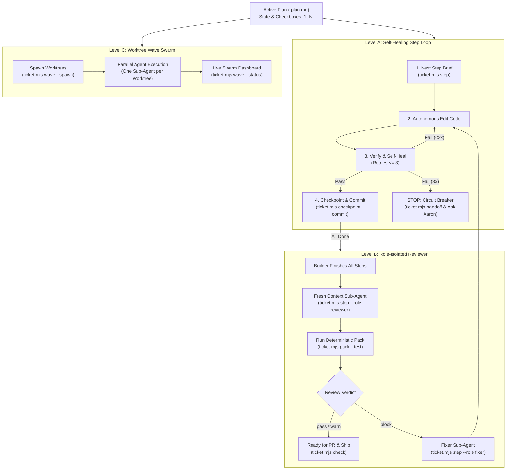

# Agentic Workflow Add-On (Levels A, B, and C)

An opt-in, modular execution layer built on top of the deterministic `AI-Dev-Workflow` core. While Layer 1 enforces plan discipline and verification honesty, Layer 2 enables autonomous self-healing loops, role-isolated adversarial reviews, and parallel git-worktree execution.

Keep this file identical in `.agents/skills/agentic-workflow/` and `.claude/skills/agentic-workflow/`.

---

## Architecture Overview



---

## Level A: Autonomous Self-Healing Step Loop

Use this when you want an agent to autonomously advance a plan step-by-step with safety guardrails.

1. **Obtain Next Step Brief:**
   ```bash
   node scripts/ticket.mjs step
   # Or for structured JSON:
   node scripts/ticket.mjs step --json
   # Or for a dedicated builder prompt:
   node scripts/ticket.mjs step --role builder
   ```

2. **Implement Step:**
   Make minimal, high-leverage changes scoped strictly to the target step.

3. **Verify & Self-Heal (Max 3 Retries):**
   Run the verification tier specified in the brief (e.g. `npm test` or `node --test scripts/ticket.test.mjs`).
   - If tests fail, analyze the error output and adjust the code.
   - **Circuit Breaker:** If tests fail 3 consecutive times, stop immediately. Record the blocker with:
     ```bash
     node scripts/ticket.mjs handoff --agent <you> --done "<what worked>" --next "<failing step>" --open "<test error details>"
     ```
     Alert the user and wait for guidance. Never loop beyond 3 retries.

4. **Checkpoint & Atomic Git Commit:**
   Once verification passes cleanly, execute:
   ```bash
   node scripts/ticket.mjs checkpoint <#> --commit
   ```
   This deterministically runs the verify command, checks that tests exit with code 0, marks the checkbox `[x]` with verified evidence, and commits the checkpoint to git.

5. **Repeat** until `node scripts/ticket.mjs step` reports all items completed.

---

## Level B: Role-Isolated Adversarial Review

Prevent confirmation bias by separating the Builder from the Reviewer.

1. **Spawn Reviewer in a Fresh Context Window:**
   Generate the adversarial review brief:
   ```bash
   node scripts/ticket.mjs step --role reviewer
   ```

2. **Run Zero-Token Review Digest:**
   The Reviewer runs:
   ```bash
   node scripts/ticket.mjs pack --test
   ```
   Inspects:
   - Spec fidelity against plan Acceptance Criteria
   - Test execution proof and regression checks
   - Verification honesty (no unsubstantiated claims)
   - Working-tree hygiene

3. **Stamp Verdict:**
   ```bash
   node scripts/ticket.mjs review --agent <client> --verdict <pass|warn|block> --summary "<concise findings>"
   ```

4. **Handling Block Verdicts (The Fixer Role):**
   If the verdict is `block`, generate a focused fixer brief:
   ```bash
   node scripts/ticket.mjs step --role fixer
   ```
   The Fixer agent receives the exact blocker findings from the Progress log, fixes the code, re-runs tests, and requests re-review.

---

## Level C: Parallel Worktree Waves

Coordinate multi-plan development across isolated git worktrees without context collisions.

1. **Provision Worktree Wave:**
   ```bash
   node scripts/ticket.mjs wave --spawn
   # Or for specific plans:
   node scripts/ticket.mjs wave docs/plans/Plan-A.plan.md docs/plans/Plan-B.plan.md --spawn
   ```
   This creates `.worktrees/<branch>` with `.env` inheritance and prints the exact builder ignition command for each worktree.

2. **Dispatch Autonomous Agents:**
   Assign a sub-agent or chat session to each worktree:
   ```bash
   cd .worktrees/<name>
   node scripts/ticket.mjs step --role builder
   ```

3. **Monitor Live Swarm Progress:**
   From the main repository or any worktree, run:
   ```bash
   node scripts/ticket.mjs wave --status
   ```
   Displays a live table tracking plan name, branch, active worktree, checkbox progress (`N/Total`), review verdict, and close-out readiness.

---

## Safety & Token-Economy Rules

- **Strict Retry Budget:** Never exceed `maxRetries: 3` without human intervention.
- **Verification Before Checkpointing:** Checkpoints only advance when tests pass with exit code 0.
- **Context Isolation:** Keep Builder and Reviewer contexts separate to ensure honest adversarial validation.
- **Zero External Dependencies:** Level A, B, and C run on pure Node.js 22+ built into `ticket.mjs`.
